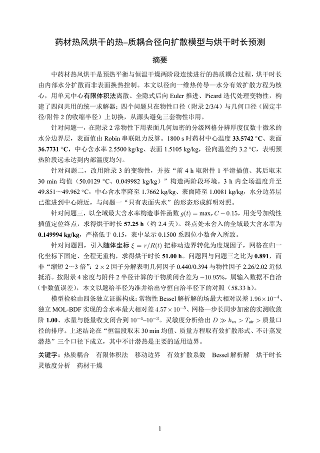

# dsh-mathmodeling-workflow

[](https://github.com/topics/dsh-plugin)
[](LICENSE)

给 [DSH](https://github.com/deepseek-ai/deepseek-harness) 用的**数学建模竞赛全流程插件**：把赛题和数据放进一个文件夹，说一句话，它就会按 8 个步骤跑完——赛题分析、建模求解、编程实现、数据图、流程图、逻辑对抗复核、论文撰写、编译出 PDF。

```text
赛题目录/ ──► 8 步流水线 ──► paper/main.pdf + 全部源码/图表/中间产物
```

## 安装

前置：DSH（桌面版或 Web 版）。用 npx 方式装需要 Node.js + pnpm（DSH 桌面版自带 pnpm；纯 Node 环境先 `npm i -g pnpm`）。

> **兼容性**：已在 DSH `0.2.2-rc.1` 实测通过（工具注册、系统提示注入、8 步流水线、提问中转、开关改写、闸门验收全部正常）。升级 DSH 后如果插件管理里显示未启用，重新启用一次即可——升级可能会重置 profile 里的 bundle 选择。

其余依赖按需装，缺哪个只影响对应那一步：

| 依赖 | 什么时候需要 |
|---|---|
| Python 3.10+（能 `import matplotlib`） | 数据图、结果核对 |
| XeLaTeX（TeX Live / MiKTeX） | 编译论文 PDF |
| Chromium 内核浏览器（Edge / Chrome） | 仅 `flowchart_engine=html` 时需要 |
| 中文字体 | 编译中文模板（初始化时会尝试从系统字体回填） |

### 方式一：npx 一条命令（推荐）

```bash
npx -y @deepseek-ai/dsh plugin --profile desktop add github:xzwwwwww/dsh-mathmodeling-workflow
```

拉取仓库 → 装进 `desktop` profile → 自动注册进 bundle 列表。Web 版把 `desktop` 换成 `web`。

### 方式二：从本地目录装

```bash
git clone https://github.com/xzwwwwww/dsh-mathmodeling-workflow.git
```

然后在 DSH 里二选一：

- **桌面端**：插件管理 → 安装 bundle → 目标填克隆下来的目录
- **Agent**：`plugin_manager({ action: "install_bundle", target: "<克隆目录的绝对路径>" })`

更新：方式一重跑 npx 命令；方式二 `git pull` 后把插件关闭再启用一次（或重启 DSH）。
卸载：插件管理里移除，或 `plugin_manager({ action: "remove_bundle", target: "@local/dsh-mathmodeling-workflow" })`。

## 使用

### 1. 把赛题和数据放进一个文件夹

```text
2026国赛A/
├─ 赛题A.docx          # 赛题原文：PDF / DOCX / MD 都行
├─ 数据.csv            # 附件数据：csv / xlsx / json
└─ 自定义要求.md        # 可选：导师规范、评审偏好、必须包含的内容
```

### 2. 在 DSH 里说一句话

```
用建模插件跑这个赛题：D:\2026国赛A
```

插件会让 agent 先确认开关（没填的用默认值并回显），再建工作区、开始逐步推进。

### 3. 提示词怎么写

**最简**（全部默认）：

```
用建模插件跑这个赛题：D:\2026国赛A
```

**带要求**（只写你在意的，其余默认）：

```
用建模插件跑：D:\2026国赛A，国赛 A 题，正文 25 页，
数据图用 nature 风格，流程图用 HTML 引擎，严格审查
```

agent 收到后会回显最终开关，然后生成工作区 `modeling-2026国赛A-<时间戳>/`。

### 4. 开关一览（21 个）

| 开关 | 取值 | 默认 | 用途 |
|---|---|---|---|
| `competition` | cumcm / wuyi / huazhong / apmcm_zh / diangong / mathorcup / zhongqing / yangtze / liaoning / huashu / huawei / mcm / icm / apmcm / generic | `cumcm` | 赛项：决定竞赛规则、默认页数、LaTeX 模板、默认语言（MCM/ICM/APMCM 英文 → en） |
| `problem_id` | A/B/C… | 空 | 题号，写进参数和规则段 |
| `title` | 任意字符串 | 空（取目录名） | 论文标题 / 赛题简称 |
| `language` | `zh` / `en` | 按赛项自动（中文赛项 zh，MCM/ICM/APMCM 英文 en） | 论文语言：决定用中文还是英文论文/编译技能、图表标签语言、正文页数估算口径（中文 900 字/页，英文 2200 字符/页） |
| `max_pages` | 正整数 | 赛项默认（多数 30，`apmcm_zh` 25，英文赛事 20） | **正文页数目标（下限）**：目录之后→参考文献之前（无目录则摘要之后→参考文献之前），不含摘要/目录/参考文献/附录/AI 声明；不是全文上限 |
| `figure_style` | `default` / `nature` | `default` | 数据图风格：default=按工作区随机配色（去指纹）；nature=Nature 排版+深蓝主色 |
| `flowchart_engine` | `drawio` / `html` | `drawio` | 流程图引擎：drawio 产物可拖拽编辑；html 布局更好、不可拖拽 |
| `diagram_style` | `mono` / `plain` / `modern` | `mono` | 流程图版式，仅 html 引擎生效 |
| `rich_mode` | true / false | `false` | 丰满模式：正文 40-60 页、30+ 图、摘要 1500-2200 字、12 类章节扩展 |
| `validation_mode` | `strict` / `fast` | `strict` | strict=完整审查（含论文数据真实性核对）；fast=省额度，跳过复核和深度自修 |
| `enable_comp_review` | true / false | `true` | 是否插入「逻辑对抗复核」步（图表之后、论文之前），关掉省一次子代理调用 |
| `ai_disclosure` | `off` / `none` / `used` | `off` | AI 声明：off 不写且不许残留；none 一句话；used 声明章节+附录四表 |
| `comp_date_start` / `comp_date_end` | `YYYY-MM-DD` | 空 | 仅 `ai_disclosure=used` 用于生成比赛期内的交互日期 |
| `skip_figures` | true / false | `false` | 跳过两个图表步 |
| `skip_drawio` | true / false | `false` | 只跳过流程图步 |
| `flow_per_problem` | true / false | `false` | 逐问流程图：开 → 每个子问题各画一张 `fig_flow_qN`；具体用 GPT Image 还是 DrawIO 由 `custom_requirements` 决定（写明 image/gpt/生图 用 GPT Image，否则 DrawIO） |
| `min_figures` / `min_tables` / `min_models` | 整数 或 `auto` | `auto` | 数量下限参考，写进 CLAUDE.md 供技能自检 |
| `custom_requirements` | 自由文本 | 空 | 自定义要求（导师规范、必须包含的内容），最高优先级，会进 CLAUDE.md |

另外 3 个不是开关的初始化参数：`input_dir`（必填，赛题目录）、`workspace_name`（工作区目录名，默认按目录名+时间戳）、`overwrite`（工作区已存在时是否重建）。

### 5. 一个完整示例

```
用建模插件跑：D:\2026国赛A，国赛 A 题，正文 25 页，
数据图用 nature 风格，流程图用 HTML 引擎（modern 版式），
AI 声明按"使用过 AI 工具"写，开启逻辑对抗复核，
自定义要求：摘要不超过一页，必须包含灵敏度分析。
```

agent 会回显类似：

```
赛项：国赛 (CUMCM)(cumcm) ｜ 题号=A ｜ 页数(正文)=25 ｜ 数据图风格=nature
流程图=html/modern ｜ 丰满模式=关 ｜ 审查=strict ｜ AI声明=used ｜ 对抗复核=开
→ 8 步，工作区 modeling-2026国赛A-20261104-2030/
```

### 6. 跑起来之后

- **每步一个子代理、串行执行**：上一步闸门通过才进下一步，主会话只做调度和验收。
- **需要你拍板时会来问你**：子代理拿不准关键信息（题号口径、数据取舍、硬性要求）会先问你，拿到回答再继续；能靠合理假设推进的，它会在产物里写明假设。
- **随时可以问进度**：`看下当前进度` → 会列出 8 步状态、产物大小和待答问题。
- **产物**：工作区根目录有 `PROBLEM_ANALYSIS.md`、`MODELING_REPORT.md`、`RESULTS.md`、`code/`、`figures/`、`paper/main.pdf`。

## 整个流程

| # | 步骤 | 干什么 |
|---|---|---|
| 01 | 赛题分析 | 拆子问题、定义变量、规划建模思路和图表清单 |
| 02 | 建模求解 | 假设、模型建立、求解、检验、逻辑合同 |
| 03 | 编程实现 | 写可运行代码、跑出结果、生成结果 JSON |
| 04 | 图表生成 | 数据图（matplotlib，按 manifest 对账） |
| 05 | 流程图/架构图 | DrawIO 或 HTML 引擎画流程、架构、TikZ 图 |
| 06 | 逻辑对抗复核 | 六类逻辑缺口复核（方向反、跨问矛盾、任务读歪…） |
| 07 | 论文撰写 | 中文：XeLaTeX；英文（MCM/ICM）：COMAP 格式、Summary Sheet、pdflatex；strict 时做数据真实性核对 |
| 08 | 编译与合规检查 | 中文：XeLaTeX；英文：pdflatex + bibtex；模板完整性、图嵌入、AI 声明合规 |

可调整：`flowchart_engine=html` 会把第 05 步换成 HTML 引擎技能；`skip_figures` 去掉 04+05；`enable_comp_review=false` 去掉 06；`fast` 模式跳过 06 的深度复核和数据核对；`language=en` 会把 07/08 换成英文论文/编译技能。

每一步结束都由**确定性闸门**验收（产物存在、图表对账、正文页数、逻辑合同、AI 声明、数据核对），不通过就带着修复提示重派，最多重试 2 次。

## 英文赛事（MCM / ICM / APMCM）

`competition=mcm|icm|apmcm` 时语言自动为 `en`（用户显式传 `language=zh` 可覆盖），论文/编译步骤自动切换成英文技能：

| 项 | 中文赛项 | 英文赛项 |
|---|---|---|
| 论文技能 | `论文撰写` | `论文撰写English`（COMAP 格式） |
| 编译技能 | `编译与合规` | `编译与合规English` |
| LaTeX 模板 | cumcm / wuyi / … | `_templates/mcm`（mcmthesis）或 `_templates/apmcm`（apmcmthesis） |
| 编译引擎 | XeLaTeX | pdflatex + bibtex |
| 结构 | 摘要 → 正文 → 参考文献 → 附录 | Summary Sheet（300-400 词）→ TOC → Introduction → Model → Results → References → Appendix |
| 页数口径 | 900 字/页 | 正文 2200 字符/页（Summary/TOC/References/Appendix 不计）；**总页数硬上限 25 页**（含摘要/目录/参考文献/附录，AI 报告另附），编译后按 PDF 实际页数验收 |
| 图表标签 | 中文 | English |

提示词示例：

```
用建模插件跑：D:\2026美赛A，MCM A 题，正文 20 页，英文论文
```

英文技能里的旧标记前缀已统一换成 `MMW_*`，与中文技能共用同一套 CLAUDE.md 标记（fast 模式、AI 声明、逐问流程等）。

## 示例成果

这是用本插件**真实跑完一整轮**产出的论文（2026 国赛 A 题「中药材热风烘干」，A4 共 35 页），不是模板占位：

[](examples/cumcm-A-demo/paper.pdf)

**[📄 点这里打开完整论文 PDF](examples/cumcm-A-demo/paper.pdf)**（GitHub 可直接在线阅读）

## 生成概念图（可选）

数据图和流程图都是**全本地**的（matplotlib / 本机浏览器渲染），不需要任何 key。

只有「概念图 / 场景图」这类需要图像模型。工作区里**已经带了配置文件**，直接打开填：

```text
<workspace>/_utils/_gpt_image_config.json
```

```json
{
  "api_key": "",
  "base_url": ""
}
```

- `api_key`：你从**中转站或官方**拿到的 key；
- `base_url`：中转站给接口地址就填（例如 `https://xxx.com/v1`），**留空则用官方** `https://api.openai.com/v1`；
- 也可以不改文件，直接设环境变量 `GPT_IMAGE_API_KEY` / `GPT_IMAGE_BASE_URL`（环境变量优先级更高）；
- 检查是否配好：`python _utils/gpt_image.py --check`；
- 想看实际发出去的提示词（含固定风格）：`python _utils/gpt_image.py --dry-run --prompt "..."`；
- 图内标注语言：`--lang auto`（默认）读工作区 `CLAUDE.md` 的 `language:` 行自动选中文/英文，也可显式 `--lang zh|en`；
- **没配也能跑**：规划里的概念图会被自动跳过，不影响其余步骤。

### 固定出图风格：MCM Academic Illustration

场景图统一按「国际数学建模竞赛优秀论文里的 Problem Background Illustration」出图，工具会自动拼上这段固定风格，不需要你写：

> Academic monochrome technical illustration, minimalist architectural and engineering schematic drawing,
> professional academic paper figure style. 纯白背景、黑白灰配色、纤细灰色线稿、二维/三维矢量（Flat 2D/3D）、
> 正视图/平视/正交视角、简化几何造型、轻微灰阴影、细引线标注；避免彩色、卡通、照片级 3D、写实、渐变、粗描边、复杂纹理。

也就是说：场景图是**黑白灰的学术插图**，不是海报/插画。你（或技能）只需要按下面三段写内容：

```text
【场景主题】城市交通系统
【场景元素】接驳车、候车乘客、道路、公交站台、调度中心
【构图要求】横向构图，主体分布合理，空间层次清晰，用细引线标注重要元素
```

`--aspect-ratio` 默认 `16:9`，适合横向放入论文正文。

### 机理图：Scientific Mechanism Diagram

除了场景图，GPT Image 还可以画**机理图**（系统机制示意图）：输入 → 核心机制 → 计算 → 输出，带圆角模块、细箭头、变量与公式。适合热传导/热网络、交通调度、火灾响应、洪水传播、供应链、能源调控这类「要讲清系统怎么运作」的题，用在论文的「问题分析 / 模型建立」章节。

加 `--style mechanism` 即可，风格由工具统一注入：

> Scientific mechanism diagram, academic system schematic, elegant research-paper figure style.
> 纯白背景、低饱和粉彩（浅蓝/浅绿/浅米/浅紫/浅粉）、圆角矩形模块、纤细箭头、中心节点层次结构、
> 必要时嵌公式与变量标注、小图标、扁平 2D 矢量、论文级排版；避免卡通、粗线、鲜艳饱和色、杂乱、写实、3D 渲染。

你只需要写内容：

```text
【主题】校园建筑热传导机理
【内容要求】
• 展示系统的主要输入、核心机制、计算过程和输出结果；
• 用圆角矩形模块表示不同功能单元；
• 用箭头表示信息流、控制流或物理传递关系；
• 在适当位置加入变量符号、参数名称和简洁公式；
• 用小图标辅助表达现实含义；
• 结构清晰，逻辑层次明确，适合出现在数学建模论文正文中。
```

可选补充关键词（按题目挑 2-4 个即可，不要堆砌）：柔和粉彩学术图表、工程期刊图、热网络示意图、紧凑型模块化布局、方程式整合信息图、圆形科学模块、清晰流线箭头、可用于出版的图表、基于机制的系统图示。

```bash
python _utils/gpt_image.py --style mechanism \
  --prompt "…【主题】【内容要求】…" \
  --output figures/fig_mechanism_q1.png --lang auto
```

同样可以先用 `--dry-run --style mechanism` 看最终提示词。

### 逐问建模框架图：Visual Modeling Framework Diagram

当你想给**每个子问题**都配一张「叙事型流程图」（graphical abstract：中间核心模型、四周输入/对比/输出面板、卡片式布局），可以用 GPT Image 的 framework 风格。它是**逐问**的，默认关闭——避免论文塞进一堆同质化框图。

**只有同时满足两个条件才会规划：**

1. `flow_per_problem: true`（开启「每问都规划流程图」）；
2. `custom_requirements` 里**明确写了用 image**，例如：

```text
自定义要求：每问的流程图请用 image 生成，不要用 DrawIO。
```

判据是「自定义要求里同时出现 image/gpt/生图 这类词 + 流程图」，否则逐问流程图仍由 DrawIO 画。

风格由工具统一注入（`--style framework`）：

> Visual modeling framework diagram, graphical abstract style, elegant academic infographic.
> 纯白背景、低饱和 pastel、卡片式圆角模块、中间核心模型、四周输入/对比/输出面板、
> 图标与迷你图表、细箭头、扁平 2D 矢量、论文级排版；避免鲜艳饱和色、卡通、杂乱、粗边框、照片级 3D。

你只需要写内容：

```text
【主题】洪水风险传播
【结构要求】
• 整体采用信息图式流程图 / graphical abstract 风格；
• 中间突出核心模型或核心函数模块；
• 周围展示不同输入场景、影响因素、参数变化、对比案例或输出结果；
• 使用箭头表示变量传递、模型作用、因果关系和前后变化；
• 适当加入地图、小图标、小曲线图、公式、前后对比面板；
• 各模块使用圆角卡片式布局，整体清晰、整洁、层次明确。
```

```bash
python _utils/gpt_image.py --style framework \
  --prompt "…【主题】【结构要求】…" \
  --output figures/fig_flow_q1.png --lang auto
```

出图前同样可以 `--dry-run --style framework` 先看最终提示词。

如果你自己有 ChatGPT 账号，也可以直接拉 Codex CLI，用它内置的 image gen 出图（本仓库的插件图标就是这么生成的）：

```bash
codex exec -i 参考图.png "按这张参考图的角色生成一张方形应用图标，纯白背景、粗描边、无文字，保存为 icon.png"
```

`codex` 不在 PATH 时，用 Codex 桌面版自带的那份：`%LOCALAPPDATA%\OpenAI\Codex\bin\<最新版本目录>\codex.exe`。

## License

MIT
